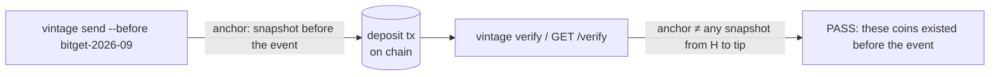

# Vintage

**Proof of age for private money.**

Every shielded Ironwood spend names an earlier state of the note tree, and consensus checks it.
Vintage turns that into a claim anyone can verify from one txid: **every coin this transaction spends
already existed before block H**. H can be any dated event: a hack's first inflow, a tax cutoff, a bug
window, a snapshot, or any block you name. Amounts, senders and history stay shielded.

- No new cryptography, no consensus change, no trusted setup
- No list of people or addresses: the registry only labels block heights
- Anyone can check any transaction against any height, from public chain data

ZECATHON 2026, Core & Tooling track. Live on Zcash mainnet:

| | |
|---|---|
| Website | [usevintage.site](https://usevintage.site) ([how it works](https://usevintage.site/how-it-works/), [simulation](https://usevintage.site/simulate/)) |
| Verifier | [app.usevintage.site](https://app.usevintage.site) |
| API | `https://api.usevintage.site` ([reference](docs/API.md), [integration guide](docs/INTEGRATION.md)) |
| Mainnet proof | [`da9017e0…e3a7`](https://mainnet.zcashexplorer.app/transactions/da9017e0fca0d8bd87def8e3faa7956067f2bd2234cfee91ca7ad4e67095e3a7): a Vintage payment that funded a NEAR Intents swap, verified `PASS` |

## Why

- When stolen funds enter the shielded pool, exit rails can't tell whether a shielded deposit contains
  them. NEAR Intents says its SHIELD screening blocked more than $50M of attempted Bitget-linked swaps. Since the
  2026-09-30 Bitget inflow into Ironwood, it can't tell whether any shielded deposit contains those coins.
- A Zcash forum thread (*"My experience exiting shielded ZEC from Zodl to NEAR Intents: $589k USDT still
  held 50 days…"*, forum.zcashcommunity.com/t/57497) shows the cost. The only "proof of innocence"
  available was to give up privacy: the author volunteered addresses, transaction hashes and swap history, and
  the funds were still held.
- Honest framing: Vintage would **not** have helped that author, whose swap predates Ironwood and whose
  review wasn't tied to a specific event. Vintage rules out **known events** for coins that predate
  them. It is not a full source-of-funds answer.

## How it works

To spend shielded coins, a wallet proves "my note is in the pool" against a snapshot of the pool (the
**anchor**). Consensus only accepts a snapshot that existed at the end of an earlier block. Vintage makes
the wallet use one from **before the event**. Coins that arrived later aren't in it and can't be spent,
and anyone can check that the transaction's snapshot is older than the event.



**Fresh coins** (received after the event) can't be dated by age. Two paths cover them:
- **Payer side** (nothing revealed): ask the payer for a Vintage payment with `vintage request`. The
  payment itself then proves its coins predate the event.
- **Receipt account** (one viewing key, one rail, optional): receive that payment into a single-use
  account, deposit from it, and let the rail check the link with `vintage link verify`. It discloses
  that one account's viewing key and nothing else; see [docs/LINK.md](docs/LINK.md).

Details: **[docs/HOW_IT_WORKS.md](docs/HOW_IT_WORKS.md)**. Limits and privacy cost:
**[docs/THREAT_MODEL.md](docs/THREAT_MODEL.md)**.

## Mainnet demo: two NEAR Intents swaps, both proven

On 2026-10-23, against the staged event `vintage-demo-2026-10` (block 3,525,709):

| | Transaction | Result |
|---|---|---|
| **Vintage payment = NEAR deposit 1.** Spends only a note from before the event (anchor 3,525,696, 2,116 blocks old). Pays 0.003 ZEC to the NEAR deposit address and funds a receipt account with two notes. | [`da9017e0…e3a7`](https://mainnet.zcashexplorer.app/transactions/da9017e0fca0d8bd87def8e3faa7956067f2bd2234cfee91ca7ad4e67095e3a7), block 3,527,813 | `vintage verify` **PASS**. NEAR swap SUCCESS: **3.668896 USDC** ([Base tx](https://basescan.org/tx/0xc1f7ac737d646c31d00539006887bf507488a5f9115bffe5d433eb1cdb9aa7a4)) |
| **Receipt account → NEAR deposit 2.** Fresh coins: spends both receipt notes, pays 0.0045 ZEC. | [`df151ee2…9402`](https://mainnet.zcashexplorer.app/transactions/df151ee2e670d683018edd85bb1bf8eca2ccefe3ff464853368c1ff949db9402), block 3,527,827 | `vintage link verify` **PASS**. NEAR swap SUCCESS: **5.52164 USDC** ([Base tx](https://basescan.org/tx/0xf25a0201f6521cf7aca2174b6f3f30bc5cf6a45b95a96447612a95d1580ffc22)) |

Reproduce both: [demo/README.md](demo/README.md). The link bundle is published at
[demo/mainnet-link-bundle.json](demo/mainnet-link-bundle.json).

The setup, also on mainnet (Oct 21):

| Step | Transaction | Height |
|---|---|---|
| "honest" wallet funded, 0.015 ZEC | [`ef383512…50ff`](https://mainnet.zcashexplorer.app/transactions/ef383512f19ff8356d96a0f81dd6cb62ec3909f2b8d8f4e5a632523af34d50ff) | 3,525,666 |
| "flagged" wallet funded = the staged event | [`e66bb554…3577`](https://mainnet.zcashexplorer.app/transactions/e66bb554e869a376e56753c03ba3637ec08a439fe409ac53600d9473e68d3577) | 3,525,709 |
| tainted transfer flagged → honest, 0.005 ZEC | [`a4c7622f…c143`](https://mainnet.zcashexplorer.app/transactions/a4c7622f2e3e39ce0cd5a65fc4417f490568990a6f90fda5579a924a0d83c143) | 3,525,726 |

The honest wallet then held 0.02 ZEC, but `vintage send` spent only the 0.015 from before the event and
refused the tainted 0.005. The tainted transfer itself verifies FAIL against the event.

## Quickstart

Build (Rust 1.89+). Release builds; the first build compiles the Zcash crates.

```sh
cargo build --release      # binaries: target/release/vintage, target/release/vintage-api
```

Check any mainnet transaction against an event (no wallet needed):

```sh
vintage verify <txid> --before bitget-2026-09
vintage verify <txid> --before 3501240 --json        # any height; JSON for machines
```

Exit codes: `0` PASS, `1` FAIL, `2` not provable. Or use the public verifier, no install:

```sh
curl 'https://api.usevintage.site/verify/<txid>?before=bitget-2026-09'
```

Make a Vintage payment from a [zcash-devtool](https://github.com/zcash/zcash-devtool) wallet. Always
`--dry-run` first; it shows which notes qualify and stops before signing:

```sh
vintage status --wallet <wallet-dir> --sync              # how much of your ZEC predates each event
vintage send --wallet <wallet-dir> -i <age-identity> \
  --to <address> --value <zatoshis> --before <event-or-height> --dry-run
```

Ask for a Vintage payment, then pay the request:

```sh
vintage request --to <your address> --amount 0.5 --before bitget-2026-09   # prints a ZIP-321 URI
vintage send --wallet <payer-wallet> -i <age-identity> --uri '<URI>' --dry-run
vintage verify <txid> --before bitget-2026-09 --received-by @my-ufvk.txt  # merchant: what did I get?
```

The receipt-account link (fresh coins; discloses one single-use account's viewing key):

```sh
vintage link prove --deposit <D> --funding <T1> --wallet <receipt-wallet> --out bundle.json
vintage link verify bundle.json --before bitget-2026-09      # what a rail runs, locally
```

`vintage send` never reads your seed. It signs through zcash-devtool (with the patches in
`patches/`), which must sit next to the `vintage` binary or be passed with `--devtool`.

## Integrating Vintage into exit-rail screening

One call per confirmed deposit:

```
GET /verify/{deposit_txid}?before={event}
```

- **PASS**: every shielded note the deposit spends existed before the event, so none of it can be the
  event's coins. This is enforced by consensus, not claimed by the user. Use it to skip event-related
  review.
- **FAIL** or **NOT_PROVABLE**: no information. Nearly every ordinary transaction FAILs. Never treat it
  as a flag, and never require Vintage from every depositor: it's the user's to offer.
- Act only on mined transactions (`"provisional": false`), and run the verifier against your own node.

The full guide, with code in three languages, self-hosting and mainnet test fixtures:
[docs/INTEGRATION.md](docs/INTEGRATION.md).

Full reference, including `POST /verify-link`: **[docs/API.md](docs/API.md)**.

## More evidence

- **The real event:** Bitget, 2026-09-30, from ZachXBT's post (t.me/investigations/364), confirmed via
  lightwalletd: [`9bf8d134…4e1a`](https://mainnet.zcashexplorer.app/transactions/9bf8d13474eff83ee9fcb214a3df7e1d1acbb745a0f820c837c08eb35e1e4e1a)
  at **3,501,240** (876.43 ZEC), [`64e5a66c…73a2`](https://mainnet.zcashexplorer.app/transactions/64e5a66cce034745dfe1447b4779ce37b910d99365d0583cef65eb0504b573a2)
  at 3,501,242, [`61d2cb33…b258`](https://mainnet.zcashexplorer.app/transactions/61d2cb335127636f2854e587dd41fecf2ec31c9c1e9e5e5b543c3a416048b258)
  at 3,501,265; 2,746.31 ZEC in total. Registry event `bitget-2026-09` (type `hack`).
- **Ordinary mainnet traffic:** 119 Ironwood transactions from 40 recent blocks, each verified against
  Bitget: **70 FAIL** (all with anchors 1–11 blocks old), **49 NOT_PROVABLE** (transparent inputs),
  **0 PASS**. No false PASS.
- **Testnet:** a Vintage payment with an **8,716-block-old** anchor was accepted by consensus
  (`2bdc5ced…c19f`, block 4,532,044); the receipt-account link on testnet, and four tampered link
  bundles that correctly FAIL, are in the build notes.

## Benchmarks

Mainnet, checking against Bitget (~25,000 blocks, ~16,000 distinct Ironwood roots):

| | Time |
|---|---|
| One root request per block (naive) | 294 s |
| First check, 16 / 4 / 2 / 1 cores | 19–25 / 41 / 64 / 90 s |
| CLI repeat check (cache) | 1.5–1.7 s |
| API repeat check (public server) | 0.06 s on the server |
| Link check (CLI, mainnet demo) | 1.75 s |

Peak memory is 15–17 MB. The cache is about 2 MB.

## Roadmap

A zero-knowledge version of the link, which proves the same thing **without** disclosing any viewing
key, is buildable with the existing Ironwood circuit: see the working spike in
`research/onehop-spike` and **[docs/ROADMAP.md](docs/ROADMAP.md)**. A draft ZIP describing the
property is in **[docs/ZIP_DRAFT.md](docs/ZIP_DRAFT.md)**.

## Repository

```
crates/vintage-core       no I/O: grid anchors, tx parsing, the verdict, the signed event registry
crates/vintage-verifier   lightwalletd access, roots from compact blocks + cache, reports, the link check
crates/vintage-cli        `vintage`: verify, send, request, link, status, tx, witness, registry
crates/vintage-api        `vintage-api`: the HTTP verifier
registry/                 events.json + ed25519 signature + public key
demo/                     the mainnet demo: how to reproduce it, and the published link bundle
research/                 one-hop zero-knowledge spike; Gate 0 check for the link
patches/                  zcash-devtool patches (`propose` and `pay` with --min-confirmations)
deploy/                   API service + reverse proxy; Cloudflare Pages guide for the website
web/                      the website: pages/ (one file per page), shared/ design system, static/ per site
scripts/                  build-web.sh + build-pages.py (static site generator), site checks, og-card.html
docs/                     HOW_IT_WORKS, INTEGRATION, API, LINK, THREAT_MODEL, ROADMAP, ZIP_DRAFT
```

## License

MIT OR Apache-2.0, at your option: [LICENSE-MIT](LICENSE-MIT), [LICENSE-APACHE](LICENSE-APACHE). Security reports: [SECURITY.md](SECURITY.md).
