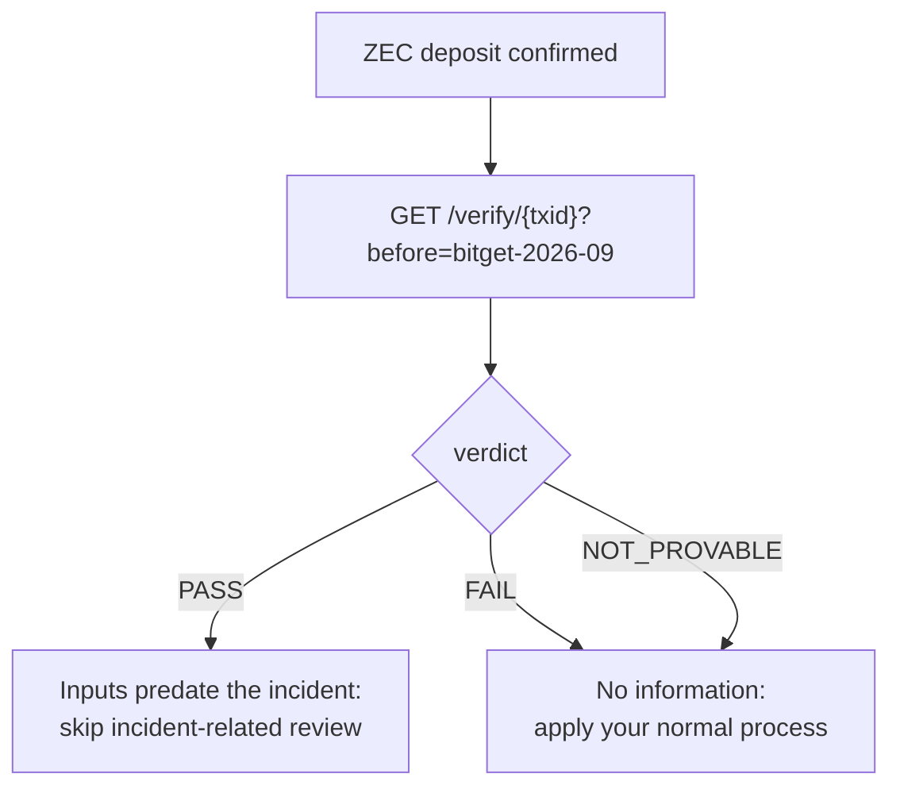

# Vintage API

`vintage-api` is a read-only HTTP verifier for exchanges, bridges and anyone else. It gives the same
verdicts as `vintage verify --json` because both use the same library (`crates/vintage-verifier`).

**Public instance:** `https://api.usevintage.site` (mainnet, for demos and quick checks; production
users should self-host against their own node, see [THREAT_MODEL.md](THREAT_MODEL.md#who-you-trust)). It
keeps no access log. Deployment files: [`deploy/`](../deploy).

```
vintage-api --network main --listen 127.0.0.1:8080 \
            --server <your-lightwalletd:443> --registry registry \
            --cache /var/lib/vintage/cache.sqlite --allow-origin https://your-frontend.example
```

| Flag | Default | Meaning |
|---|---|---|
| `--listen` | `127.0.0.1:8080` | Address to serve on. Put it behind a TLS reverse proxy. |
| `--network` | `main` | `main` or `test`. |
| `--server` | zec.rocks for the network | lightwalletd/Zaino gRPC `host:port` (TLS). For production, your own. |
| `--registry` | `registry` | Directory with `incidents.json`, `incidents.json.sig`, `pubkey.hex`. The signature is checked at startup. |
| `--cache` | `~/.cache/vintage/cache.sqlite` | Root cache. About 2 MB per 25,000 blocks. |
| `--allow-origin` | `*` | `Access-Control-Allow-Origin` value. |
| `--max-parallel` | `4` | Verifications at once; more wait their turn. |
| `--refresh-secs` | `30` | Background refresh that keeps roots computed from the earliest incident to the tip. `0` disables it. |

Resources: ~16 MB RAM. Any core count works; more cores only speed up the very first cache fill (see
[HOW_IT_WORKS.md](HOW_IT_WORKS.md#the-fast-verifier)).

## Endpoints

### `GET /verify/{txid}?before={height | incident-id}`

Checks whether every Ironwood input of `txid` existed before the given block height, or before the
incident's first inflow height.

**200**: a verdict. All three verdicts are normal results, not errors.

```json
{
  "txid": "ef383512f19ff8356d96a0f81dd6cb62ec3909f2b8d8f4e5a632523af34d50ff",
  "network": "main",
  "mined_height": 3525666,
  "provisional": false,
  "chain_tip": 3526685,
  "before": {
    "height": 3501240,
    "label": "Bitget hot-wallet exploit: first shielding into Ironwood",
    "requested": "bitget-2026-09"
  },
  "verdict": "FAIL",
  "summary": "Can't prove these coins existed before block 3501240 (Bitget hot-wallet exploit: first shielding into Ironwood).",
  "anchor": "8383d9a3cca29dc7baa33879129b2e72af3ea434300094b164fa5c7628f5e00e",
  "matched_heights": [3525663, 3525663],
  "root_existed_before_h": false,
  "evidence": {
    "blocks_covered": 25446,
    "distinct_roots": 16118,
    "blocks_downloaded": 0,
    "blocks_from_cache": 25447,
    "server_tree_checks": 0
  },
  "elapsed_secs": 0.275
}
```

| Field | Meaning |
|---|---|
| `verdict` | `PASS`, `FAIL` or `NOT_PROVABLE`. |
| `summary` | One plain-language sentence, ready to show to a person. |
| `provisional` | `true` while the transaction is unmined. Re-check after it's mined: until then the same txid could be mined with a different anchor ([THREAT_MODEL.md](THREAT_MODEL.md#unmined-transactions-same-txid-different-anchor)). |
| `reasons` | For `NOT_PROVABLE`: e.g. `"transparent inputs"`, `"Sapling spends"`, `"Orchard spends"`, `"no Ironwood bundle"`. |
| `anchor` | The transaction's Ironwood anchor (hex). |
| `matched_heights` | For `FAIL`: first and last height ≥ H whose root equals the anchor. |
| `root_existed_before_h` | For `FAIL`: the matching root already existed at H − 1 (no notes were added in between), so the coins *may* predate H; a spend anchored earlier would prove it. |
| `evidence` | How many blocks were covered and how many distinct roots ruled out. `blocks_downloaded` / `server_tree_checks` > 0 when new blocks were computed and cross-checked against the server for this request. |

**Errors**: JSON `{"error": "…"}`.

| Status | When |
|---|---|
| 400 | Malformed txid; missing `before`; unknown incident id; H not after Ironwood's activation (mainnet block 3,428,143) or above the tip. |
| 404 | The server doesn't know the transaction. |
| 502 | lightwalletd error. |

### `GET /incidents`

The registry entries for this network, its public key and the paths of the signed files.

```json
{
  "network": "main",
  "signature_verified": true,
  "public_key": "d36b99d806299b331c233046d98a7d77c02fb4d0dc727ba413230371a9dc4376",
  "signed_file": "/registry/incidents.json",
  "signature_file": "/registry/incidents.json.sig",
  "incidents": [
    {
      "id": "bitget-2026-09",
      "label": "Bitget hot-wallet exploit: first shielding into Ironwood",
      "network": "main",
      "first_inflow_height": 3501240,
      "txids": ["9bf8d134…4e1a", "64e5a66c…73a2", "61d2cb33…b258"],
      "sources": ["https://t.me/investigations/364", "https://www.coindesk.com/markets/2026/09/30/…"],
      "added_at": "2026-10-21",
      "notes": "Txids from ZachXBT's post. Heights and amounts confirmed via lightwalletd GetTransaction on mainnet: … This entry labels a height only: it names no person or address."
    },
    { "id": "vintage-demo-2026-10", "label": "Vintage demo: simulated incident (not a real hack)", "…": "…" }
  ]
}
```

(Shortened here: the endpoint returns full txids, sources and notes.)

### `GET /registry/incidents.json`, `GET /registry/incidents.json.sig`

The exact signed bytes and the hex ed25519 signature, so a client can verify the registry without
trusting the API. The signature covers the file bytes exactly as served.

### `GET /health`

`{"status":"ok","network":"main","server":"zec.rocks:443","chain_tip":3526684}`, or 502 if lightwalletd
is unreachable.

## Measured

Local run against zec.rocks, mainnet, `before=bitget-2026-09` (~25,400 blocks):

- repeat requests: **0.20–0.39 s** (HTTP 200)
- the first request after a new block, before the background refresh caught it: 1.1 s
- background refresh of 102 new blocks: 1.2 s
- error paths: bad txid / missing `before` / unknown incident answer in < 1 ms; unknown txid → 404 in 0.2 s

## Integrating Vintage into exit-rail screening

For a rail like NEAR Intents' SHIELD, or an exchange's deposit screening. The deposit is a Zcash
transaction your rail already watches. After it confirms:

```
GET /verify/{deposit_txid}?before={incident}
```

for each incident you screen for. Or one call with the earliest incident: a PASS against the earliest
height also clears every later one.



**What a PASS means:** every shielded note spent by the deposit existed before the incident's first
inflow into Ironwood, so none of those notes can be the incident's coins or anything derived from them.
This is enforced by consensus, not claimed by the user.

**What a PASS does not mean:** that the depositor is who they say they are, that the coins are clean of
*earlier* incidents (check against each height you care about), or anything about the destination.

**What a FAIL does not mean:** that the coins are stolen. Nearly every ordinary transaction FAILs.
Treat FAIL as "no information", and never as a flag.

Practical notes:

- Only act on `provisional: false`.
- Run against your own lightwalletd/Zaino for production (`--server`). The public endpoint is for demos.
- The user makes the deposit with `vintage send --before <incident> --to <your deposit address>`. Your
  deposit address can be shielded or transparent: the proof is about the deposit's *inputs*.
