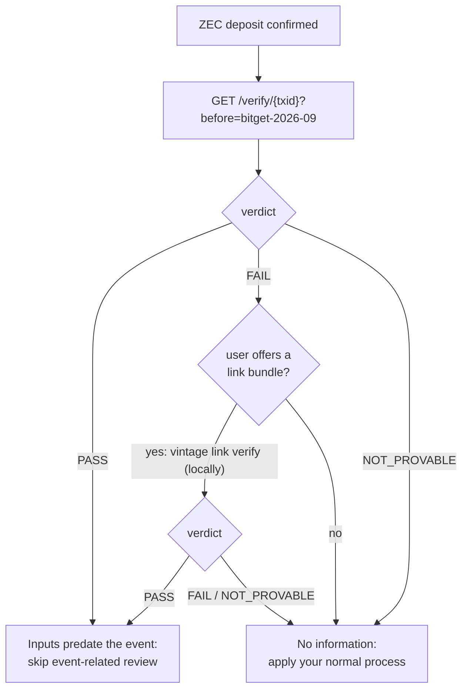

# Vintage API

`vintage-api` is a read-only HTTP verifier for exchanges, bridges and anyone else. It gives the same
verdicts as `vintage verify --json` and `vintage link verify --json`, because all three use the same
library (`crates/vintage-verifier`).

**Public instance:** `https://api.usevintage.site` (mainnet, for demos and quick checks; production
users should self-host against their own node, see [THREAT_MODEL.md](THREAT_MODEL.md#who-you-trust)). It
keeps no request log, over HTTPS or plain HTTP, and its only record of use is the anonymous counts at
`/stats`. Deployment files: [`deploy/`](../deploy).

```
vintage-api --network main --listen 127.0.0.1:8080 \
            --server <your-lightwalletd:443> --registry registry \
            --cache /var/lib/vintage/cache.sqlite --allow-origin https://your-frontend.example
```

| Flag | Default | Meaning |
|---|---|---|
| `--listen` | `127.0.0.1:8080` | Address to serve on. Put it behind a TLS reverse proxy. |
| `--network` | `main` | `main` or `test`. |
| `--server` | zec.rocks for the network | lightwalletd/Zaino gRPC `host:port` (TLS). For production, your own. |
| `--registry` | `registry` | Directory with `events.json` (or the older `incidents.json`), its `.sig`, and `pubkey.hex`. The signature is checked at startup. |
| `--cache` | `~/.cache/vintage/cache.sqlite` | Root cache. About 2 MB per 25,000 blocks. |
| `--stats` | `stats.sqlite` next to the cache | Anonymous daily counts for `/stats` (no txids, no IPs). |
| `--allow-origin` | `*` | `Access-Control-Allow-Origin` value. |
| `--max-parallel` | `4` | Verifications at once; more wait their turn. |
| `--refresh-secs` | `30` | Background refresh that keeps roots computed from the earliest event to the tip. `0` disables it. |

Resources: ~16 MB RAM. Any core count works; more cores only speed up the very first cache fill (see
[HOW_IT_WORKS.md](HOW_IT_WORKS.md#the-fast-verifier)).

## Endpoints

| Method and path | What |
|---|---|
| `GET /verify/{txid}?before={height \| event-id}` | Age check: do all of this transaction's Ironwood inputs predate the event? |
| `GET /age/{txid}` | Proven age, no event: the block by which every coin it spends was in the pool, and which registered events that predates. |
| `POST /verify-link` | The receipt-account link (fresh coins). Takes a viewing key; stateless. |
| `GET /events` | The signed event registry for this network |
| `GET /registry/events.json`, `GET /registry/events.json.sig` | The exact signed bytes and signature |
| `GET /stats` | Anonymous usage counts |
| `GET /health` | Network, server, chain tip |
| `GET /incidents`, `GET /registry/incidents.json(.sig)` | Aliases kept from version 1 |

### `GET /verify/{txid}?before={height | event-id}`

Checks whether every Ironwood input of `txid` existed before the given block height, or before the
registry event's height. Never asks for a key.

**200**: a verdict. All three verdicts are normal results, not errors. Real response for the mainnet
demo's Vintage payment:

```json
{
  "txid": "da9017e0fca0d8bd87def8e3faa7956067f2bd2234cfee91ca7ad4e67095e3a7",
  "network": "main",
  "mined_height": 3527813,
  "provisional": false,
  "chain_tip": 3527903,
  "before": {
    "height": 3525709,
    "label": "Vintage demo, a staged event, not a real hack",
    "requested": "vintage-demo-2026-10",
    "event_type": "custom"
  },
  "verdict": "PASS",
  "summary": "These coins existed before block 3,525,709 (Vintage demo, a staged event, not a real hack).",
  "anchor": "855ccc99a779159d9d98664d1a09737814b930cc782b149660a94a3881d98502",
  "evidence": {
    "blocks_covered": 2195,
    "distinct_roots": 1362,
    "blocks_downloaded": 101,
    "blocks_from_cache": 2095,
    "server_tree_checks": 2
  },
  "elapsed_secs": 1.281
}
```

| Field | Meaning |
|---|---|
| `verdict` | `PASS`, `FAIL` or `NOT_PROVABLE`. |
| `summary` | One plain-language sentence, ready to show to a person. |
| `provisional` | `true` while the transaction is unmined. Re-check after it's mined: until then the same txid could be mined with a different anchor ([THREAT_MODEL.md](THREAT_MODEL.md#unmined-transactions-same-txid-different-anchor)). |
| `before.event_type` | `hack`, `tax_cutoff`, `bug_window`, `snapshot` or `custom`; absent for a plain height. |
| `reasons` | For `NOT_PROVABLE`: e.g. `"transparent inputs"`, `"Sapling spends"`, `"Orchard spends"`, `"no Ironwood bundle"`. |
| `anchor` | The transaction's Ironwood anchor (hex). |
| `matched_heights` | First and last height ≥ H whose root equals the anchor: for `FAIL`, and for a `PASS` where block H added no notes (the anchor is then the pool as it already was at H − 1). |
| `age` | `existed_by_height`, `existed_by_time` (unix seconds) and `exact`: every coin the transaction spends was in the pool by the end of that block. `exact: false` means the anchor is older than the 50,000-block search, so this is a lower bound. Present for `PASS` and `FAIL`. |
| `evidence` | Blocks covered, distinct roots ruled out, and how many blocks were computed and cross-checked against the server for this request. |

**Errors**: JSON `{"error": "…"}`.

| Status | When |
|---|---|
| 400 | Malformed txid; missing `before`; unknown event id; H not after Ironwood's activation (mainnet block 3,428,143) or above the tip. |
| 404 | The server doesn't know the transaction. |
| 502 | lightwalletd error. |

### `GET /age/{txid}`

The coins' proven age, with no event to choose: the first block whose Ironwood root equals the
transaction's anchor. The tree is append-only, so the anchor names one pool state, and every spent coin
was in it. `events` lists each registered event and whether the coins predate it. Real response:

```json
{
  "txid": "da9017e0fca0d8bd87def8e3faa7956067f2bd2234cfee91ca7ad4e67095e3a7",
  "network": "main",
  "mined_height": 3527813,
  "provisional": false,
  "chain_tip": 3529889,
  "verdict": "DATED",
  "summary": "Every coin this transaction spends was in the shielded pool by block 3525693.",
  "anchor": "855ccc99a779159d9d98664d1a09737814b930cc782b149660a94a3881d98502",
  "age": { "existed_by_height": 3525693, "existed_by_time": 1792598612, "exact": true },
  "events": [
    { "id": "bitget-2026-09", "event_type": "hack", "height": 3501240, "predates": false, "label": "…" },
    { "id": "vintage-demo-2026-10", "event_type": "custom", "height": 3525709, "predates": true, "label": "…" }
  ],
  "elapsed_secs": 0.468
}
```

`verdict` is `DATED`, or `NOT_PROVABLE` with `reasons` for transactions with non-Ironwood inputs. Errors
as for `/verify`. Counted in `/stats` under the event `age lookup`.

### `POST /verify-link`

The receipt-account link ([LINK.md](LINK.md)): proves every coin a deposit spends came from Vintage
payments that pass the age check. **It is the only endpoint that takes a key**, and it is optional.

Privacy: the request carries a single-use receipt account's viewing key. The API holds it in memory for
that request only and drops it when the response is sent. It is never written to disk, a log, a cache, a
queue or an error tracker; the response doesn't echo it; errors log their class only. A rail that wants
to send the key to nobody runs `vintage link verify` locally instead: same check, same output.

Request (`content-type: application/json`; the bundle is what `vintage link prove` writes):

```json
{
  "before": "vintage-demo-2026-10",
  "bundle": {
    "version": 1,
    "network": "main",
    "ufvk": "uview1…",
    "deposit": "df151ee2e670d683018edd85bb1bf8eca2ccefe3ff464853368c1ff949db9402",
    "funding": [ { "txid": "da9017e0fca0d8bd87def8e3faa7956067f2bd2234cfee91ca7ad4e67095e3a7", "outputs": [1, 2] } ]
  }
}
```

**200**: real response for the mainnet demo's deposit (shortened `summary` strings aside, verbatim):

```json
{
  "network": "main",
  "before": { "height": 3525709, "label": "Vintage demo, a staged event, not a real hack", "requested": "vintage-demo-2026-10", "event_type": "custom" },
  "verdict": "PASS",
  "summary": "Every coin this deposit spends came from 1 payment whose coins existed before block 3,525,709 (Vintage demo, a staged event, not a real hack).",
  "provisional": false,
  "deposit": { "txid": "df151ee2e670d683018edd85bb1bf8eca2ccefe3ff464853368c1ff949db9402", "mined_height": 3527827 },
  "funding": [
    {
      "txid": "da9017e0fca0d8bd87def8e3faa7956067f2bd2234cfee91ca7ad4e67095e3a7",
      "verdict": "PASS",
      "summary": "These coins existed before block 3,525,709 (…).",
      "mined_height": 3527813,
      "anchor": "855ccc99a779159d9d98664d1a09737814b930cc782b149660a94a3881d98502",
      "received": [
        { "output": 1, "value_zat": 300000, "scope": "external", "spent_by_deposit": true },
        { "output": 2, "value_zat": 300000, "scope": "external", "spent_by_deposit": true }
      ]
    }
  ],
  "inputs": [
    { "action": 0, "funded_by": { "txid": "da9017e0…", "output": 1, "value_zat": 300000 } },
    { "action": 1, "funded_by": { "txid": "da9017e0…", "output": 2, "value_zat": 300000 } }
  ],
  "covered_value_zat": 600000,
  "disclosed": "The receipt account's viewing key, therefore the funding payments, the amounts received, the receipt address, and the deposit. Nothing from the user's other accounts. The viewing key cannot spend. Rotate to a fresh receipt account for every use.",
  "elapsed_secs": 2.215
}
```

| Field | Meaning |
|---|---|
| `verdict` | `PASS` (every input covered and every funding payment passes), `FAIL`, or `NOT_PROVABLE` (the deposit has non-Ironwood inputs, see `deposit.reasons`). |
| `funding[].verdict` | Each funding payment's own age check. |
| `inputs[]` | One per Ironwood action of the deposit; `funded_by: null` means that input isn't covered (for example a wallet's dummy input, see [LINK.md](LINK.md#a-limitation-found-while-building-it-wallet-dummy-inputs)). |
| `disclosed` | The disclosure statement, verbatim, for the UI. |

Errors: 400 for a malformed body (a generic message, nothing echoed), a version or network mismatch, no
or more than 16 funding payments, an undecodable key, or a txid not found; 502 for lightwalletd errors.
Browsers send a preflight first; `OPTIONS /verify-link` answers 204 with
`access-control-allow-methods: GET, POST, OPTIONS` and `access-control-allow-headers: content-type`.

### `GET /events`

The registry entries for this network, its public key and the paths of the signed files.

```json
{
  "network": "main",
  "signature_verified": true,
  "public_key": "d36b99d806299b331c233046d98a7d77c02fb4d0dc727ba413230371a9dc4376",
  "signed_file": "/registry/events.json",
  "signature_file": "/registry/events.json.sig",
  "event_types": ["hack", "tax_cutoff", "bug_window", "snapshot", "custom"],
  "events": [
    {
      "id": "bitget-2026-09",
      "type": "hack",
      "label": "Bitget hot-wallet exploit: first shielding into Ironwood",
      "network": "main",
      "height": 3501240,
      "txids": ["9bf8d134…4e1a", "64e5a66c…73a2", "61d2cb33…b258"],
      "sources": ["https://t.me/investigations/364", "https://www.coindesk.com/markets/2026/09/30/…"],
      "added_at": "2026-10-21",
      "notes": "… This entry labels a height only: it names no person or address."
    },
    { "id": "vintage-demo-2026-10", "type": "custom", "label": "Vintage demo, a staged event, not a real hack", "height": 3525709, "…": "…" }
  ]
}
```

(Shortened here: the endpoint returns full txids, sources and notes.) `GET /incidents` returns the same
body plus an `incidents` array whose entries also carry the old `first_inflow_height` field.

### `GET /registry/events.json`, `GET /registry/events.json.sig`

The exact signed bytes and the hex ed25519 signature, so a client can verify the registry without
trusting the API. The signature covers the file bytes exactly as served.

### `GET /stats`

Anonymous usage counts, public on purpose: daily totals of completed checks, by verdict and by event.
Illustrative example (shape exact, numbers made up):

```json
{
  "what_is_counted": "Only daily totals of completed checks, by verdict and by event. No transaction ids, IP addresses, times of day or other request details are recorded.",
  "since": "2026-10-23",
  "total_checks": 5,
  "by_verdict": { "FAIL": 2, "LINK_PASS": 1, "NOT_PROVABLE": 1, "PASS": 1 },
  "by_event": { "bitget-2026-09": 3, "custom height": 1, "vintage-demo-2026-10": 1 },
  "days": [ { "day": "2026-10-23", "counts": { "FAIL": 2, "LINK_PASS": 1, "NOT_PROVABLE": 1, "PASS": 1, "total": 5 } } ]
}
```

Age checks count as `PASS`, `FAIL`, `NOT_PROVABLE`; link checks as `LINK_PASS`, `LINK_FAIL`,
`LINK_NOT_PROVABLE`. A check against a height that isn't a registry event counts as `"custom height"`,
without the height. Malformed requests and errors aren't counted. `by_incident` repeats `by_event` for
older clients.

### `GET /health`

`{"status":"ok","network":"main","server":"zec.rocks:443","chain_tip":3527903}`, or 502 if lightwalletd
is unreachable.

## Measured

On the public server (2 cores), mainnet:

- `/verify` repeat checks: **0.065–0.08 s** server-side; 0.9 s total from a client in another region,
  mostly the TLS handshake
- the mainnet demo's Vintage payment: PASS in 0.056 s
- error paths: bad txid / missing `before` / unknown event answer in < 1 ms; unknown txid → 404 in 0.2 s

Local, testnet: `POST /verify-link` PASS in 5.6 s on a cold cache; the CLI's link check on mainnet took
1.75–2.2 s.

## Integrating Vintage into exit-rail screening

For a rail like NEAR Intents' SHIELD, or an exchange's deposit screening. The deposit is a Zcash
transaction your rail already watches. After it confirms:

```
GET /verify/{deposit_txid}?before={event}
```

for each event you screen for. Or one call with the earliest event: a PASS against the earliest
height also clears every later one.



**What a PASS means:** every shielded note spent by the deposit existed before the event, so none of
those notes can be the event's coins or anything derived from them. This is enforced by consensus, not
claimed by the user. A link PASS means every coin came from payments with that property.

**What a PASS does not mean:** that the depositor is who they say they are, that the coins are clean of
*earlier* events (check against each height you care about), or anything about the destination.

**What a FAIL does not mean:** that the coins are stolen. Nearly every ordinary transaction FAILs.
Treat FAIL as "no information", and never as a flag.

**Opt-in, never a gate.** Vintage is something a user offers to get an honest deposit through. Don't
require it from every depositor.

Practical notes:

- Only act on `provisional: false`.
- Run against your own lightwalletd/Zaino for production (`--server`). The public endpoint is for demos.
- Run link checks locally with `vintage link verify`, so the viewing key goes to nobody else.
- The user makes the deposit with `vintage send --before <event> --to <your deposit address>`. Your
  deposit address can be shielded or transparent: the proof is about the deposit's *inputs*. NEAR
  Intents issued transparent deposit addresses for both demo swaps.
