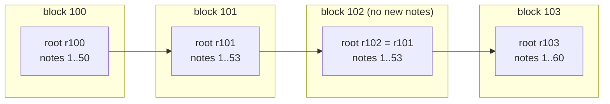
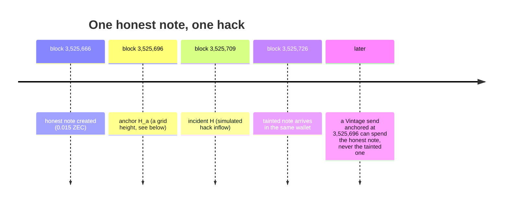
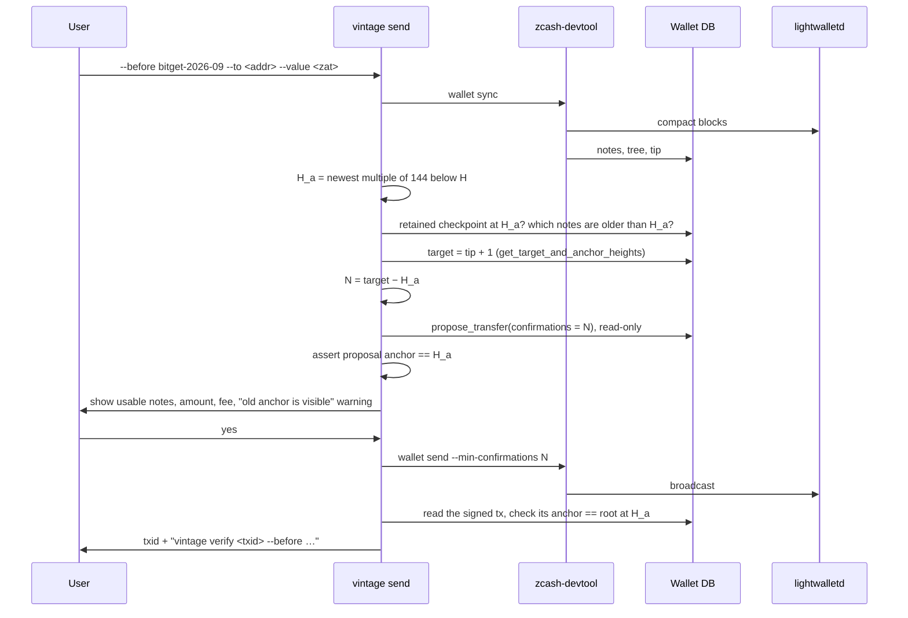
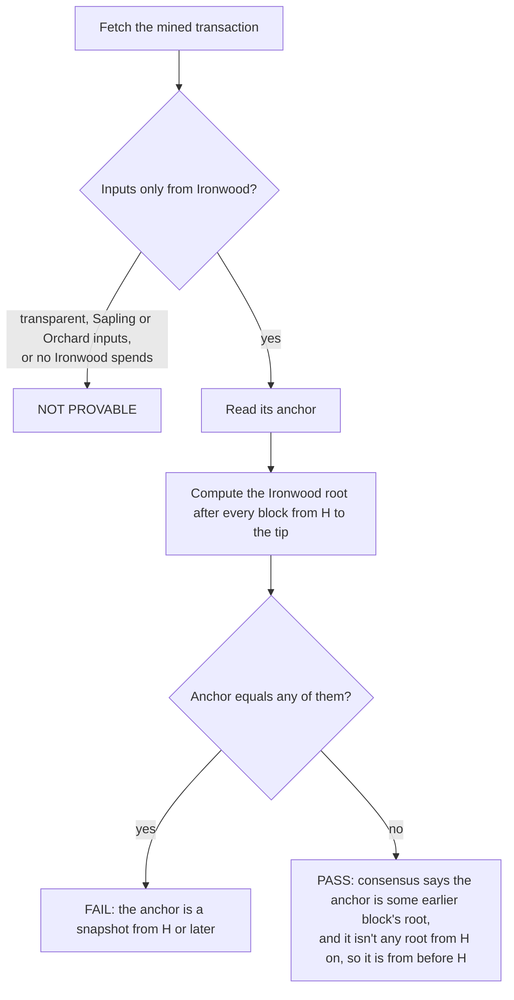
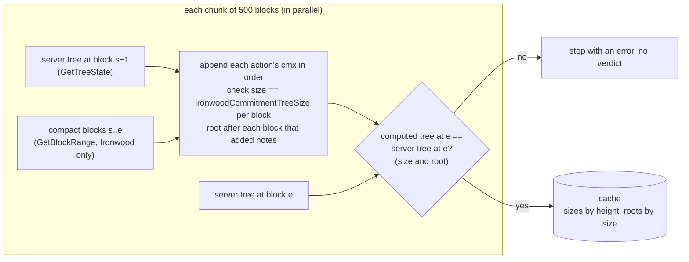

# How Vintage works

Vintage proves one thing about a Zcash transaction: **every Ironwood note it spends already existed
before block H.** It needs no new cryptography and no list of suspects. It reads a field that every
Ironwood spend already carries, and that consensus already checks.

- [The one-paragraph version](#the-one-paragraph-version)
- [Background: anchors](#background-anchors)
- [Why an old anchor proves old coins](#why-an-old-anchor-proves-old-coins)
- [Making a Vintage send](#making-a-vintage-send)
- [Checking a transaction](#checking-a-transaction)
- [The fast verifier](#the-fast-verifier)
- [The incident registry](#the-incident-registry)
- [What the verdicts mean](#what-the-verdicts-mean)

## The one-paragraph version

To spend shielded coins, a wallet proves "my note is in the pool" against a snapshot of the pool, called
the **anchor**. Consensus only accepts a snapshot that existed at the end of some earlier block. Wallets
normally use one from a few blocks ago. Vintage makes the wallet use one from **before a hack**. Coins
that arrived after the hack aren't in that snapshot, so they can't be spent in that transaction, and the
network enforces it. Anyone can then look at the transaction's anchor and check that it is an
**older snapshot than the hack**.

## Background: anchors

Ironwood keeps every shielded note ever created as a leaf in an append-only Merkle tree: the **note
commitment tree**. After each block, the tree has a root. That root is a 32-byte fingerprint of every
note in the pool up to that block.

An Ironwood spend names one of these roots as its **anchor** and includes a zero-knowledge proof that
each note it spends is a leaf of the tree with that root. The consensus rule, as cited in Zebra's
`zebra_state/src/service/check/anchors.rs` from the
[protocol specification](https://zips.z.cash/protocol/protocol.pdf#actions):

> The anchorIronwood field of the transaction, whenever it exists (i.e. when there are any Ironwood
> Action descriptions), MUST refer to some earlier block's final Ironwood treestate.

[ZIP 229](https://zips.z.cash/zip-0229) defines the field: `anchorIronwood`, 32 bytes, one per
transaction, shared by every action in it: "A root of the Ironwood note commitment tree at some block
height in the past."

## Why an old anchor proves old coins

Suppose the anchor is the root after block A, and A < H:

1. The proof shows every spent note is a leaf of the tree as it stood after block A.
2. The tree after block A only contains notes created at or before block A.
3. So every spent note existed at block A, before H.

These are the real mainnet heights from our demo. The tainted note is **not in the tree at
3,525,696**, so no proof exists that it is. We asked the wallet for each note's Merkle path at that
anchor. For the honest note it gave `WITNESS OK`. For the tainted note it refused: `Tree does not
contain a root at address … 824517`.

## Making a Vintage send

Wallets don't choose an anchor directly. librustzcash derives it as `anchor = target height −
confirmations` (`zcash_client_backend` `propose_transfer`, which reads the target from the wallet's own
stored chain tip), and it has no "use this anchor" option. So `vintage send` sets the confirmations
instead:

Design points:

- **Grid heights.** H_a is a multiple of 144 (the [ZIP 318](https://zips.z.cash/zip-0318) anchor grid).
  librustzcash wallets keep a durable tree checkpoint at those heights, so a witness can still be built
  there long after ordinary checkpoints are pruned. A wallet can only make a Vintage send for H if it
  was scanning before H_a.
- **No race.** Nothing syncs between reading the target and proposing, so the tip can't move between
  them. A new block between two runs just changes N; the anchor stays on H_a (observed: N 171 → 172,
  anchor 3,525,696 both times).
- **Vintage never touches the seed.** Signing happens in zcash-devtool. Vintage proposes read-only first,
  then devtool re-proposes from the same unchanged wallet state and gets the same plan.
- **Spending is restricted, not just displayed.** With 0.02 ZEC in the wallet, of which 0.015 is older
  than H_a, asking for 0.016 fails with `Insufficient balance (have 1500000 …)`.

## Checking a transaction

Given a transaction and a height H:

PASS needs no knowledge of where the anchor is from. It only needs to rule out every snapshot from H
onwards. That is complete, because there are finitely many blocks from H to the tip.

**The conservative edge.** If no notes were added between some block A < H and H, the roots at A and
H are identical. A transaction anchored at A then FAILs against H, even though its coins do predate H.
Vintage never gives a false PASS; in this case it can give a FAIL for coins that are in fact old enough,
and it says so (`root_existed_before_h: true`).

## The fast verifier

The naive check asks the server for each block's root (`GetTreeState`), at about 40 per second. Against
the Bitget incident that is ~25,000 blocks, and on mainnet ~63% of blocks add Ironwood notes (15,685 of
24,762). That came to 294 s.

Instead, Vintage rebuilds the roots itself from compact blocks, in parallel chunks, and cross-checks
the server:

- The tree only grows, so its root is determined by its size. The cache stores **sizes by height** and
  **roots by size**.
- Only blocks at least 100 below the tip go into the SQLite cache. Newer ones are kept in memory, tagged
  with the tip's block hash, and dropped when the tip changes. So a reorg can't leave a wrong root
  behind.
- The proto fields used: `ChainMetadata.ironwoodCommitmentTreeSize`, `CompactTx.ironwoodActions[].cmx`,
  `BlockRange.poolTypes = [IRONWOOD]` (`zcash_client_backend/proto`).

Measured on mainnet against Bitget (~25,000 blocks):

| | Time |
|---|---|
| Naive, one root request per block | 294 s |
| Fast, first check (16 cores) | 19–25 s |
| Fast, first check (4 / 2 / 1 cores) | 41 / 64 / 90 s |
| Fast, CLI repeat check (cache) | 1.5–1.7 s |
| API, repeat check (open connection + memory layer) | 0.20–0.39 s |

Peak memory is 15–17 MB in every case.

## The incident registry

`registry/incidents.json` labels block heights, for example "Bitget hot-wallet exploit: first
shielding into Ironwood, block 3,501,240", with the source transactions and links. It is signed with
ed25519 (`registry/incidents.json.sig`, public key `registry/pubkey.hex`), and every tool checks the
signature before using it.

The registry is a convenience, not an authority. It **names no people and no addresses**, and anyone
can verify against any height they like (`--before 3501240` works without it). It is not a blocklist:
it never says a coin is bad, only "this is when something happened".

## What the verdicts mean

| Verdict | Meaning | What it does **not** mean |
|---|---|---|
| **PASS** | Every Ironwood note this transaction spends existed before block H. | Nothing about who sent it, where the coins came from before that, or any later incident. |
| **FAIL** | Vintage can't show the inputs predate H: the anchor is a snapshot from H or later. | That the coins are stolen. Almost every ordinary transaction FAILs: in a sample of 119 recent mainnet Ironwood transactions, all 70 with Ironwood spends had anchors 1–11 blocks old. |
| **NOT PROVABLE** | The transaction spends transparent, Sapling or Orchard coins, or no Ironwood notes. Vintage can only reason about Ironwood. | Anything about those coins. |

A verdict on an unmined transaction is marked `provisional`. In v6 transactions the anchor is
authorizing data and not part of the txid ([ZIP 229](https://zips.z.cash/zip-0229)), so until it is
mined, the same txid could be mined with a different anchor. See [THREAT_MODEL.md](THREAT_MODEL.md).
