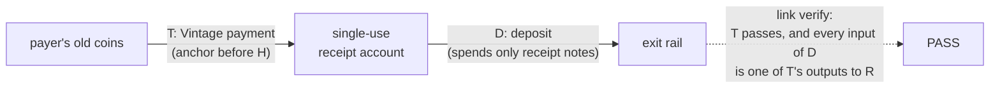

# Fresh coins: payer-side requests and the receipt-account link

An age proof ([HOW_IT_WORKS.md](HOW_IT_WORKS.md)) covers coins that existed before an event. Coins you
**received after** the event can't be dated that way: any later note could, in principle, descend from
the event's coins. Vintage has two paths for them. The first reveals nothing. The second is optional,
reveals one single-use account, and is the only Vintage feature that discloses anything.

## 1. Payer side: ask for a Vintage payment (nothing revealed)

If the person paying you holds coins from before the event, they can pay you with a Vintage payment.
The payment then proves its own coins predate the event, and so do the notes you receive from it.

```sh
vintage request --to <your address> --amount 0.5 --before bitget-2026-09
# prints a ZIP-321 URI; each shielded payment's memo says "VINTAGE before=3501240"
vintage send --wallet <payer-wallet> -i <age-identity> --uri '<URI>'      # the payer
vintage verify <txid> --before bitget-2026-09 --received-by @my-ufvk.txt   # you, locally
```

ZIP 321 has no field for "use an anchor before H", and an unknown `req-` parameter would make other
wallets reject the URI. So the rule travels in the memo. A Vintage-aware payer reads it; any other wallet
still pays. `--received-by` decrypts, on your own machine, which outputs went to your key and how much.

## 2. The receipt-account link (discloses one viewing key, optional)

To deposit those fresh coins somewhere that wants proof, show that **every coin in your deposit came
from a Vintage payment**.

**Statement proven:** every Ironwood coin spent by deposit `D` was created by payments `T₁…Tₙ`, and each
`Tᵢ` passes the age check against `H`.



```sh
vintage link prove --deposit <D> --funding <T1>[,<T2>…] --wallet <receipt-wallet> --out bundle.json
vintage link verify bundle.json --before <event|height>      # or POST /verify-link
```

How the check works:

1. Each `Tᵢ` must PASS the ordinary age check against `H`, and be mined.
2. The receipt account's viewing key trial-decrypts each `Tᵢ`'s Ironwood outputs (both the external and
   the internal key scope) and recomputes each recovered note's nullifier.
3. **Every** nullifier in `D` must be one of those. Any other input means FAIL.
4. `D` must spend only Ironwood notes (the same scope rule as the age check).

The bundle is `{version, network, ufvk, deposit, funding: [{txid, outputs}]}`.

### What is disclosed (verbatim, as the tools and the site say it)

> The receipt account's viewing key, therefore the funding payments, the amounts received, the receipt
> address, and the deposit. Nothing from the user's other accounts. The viewing key cannot spend. Rotate
> to a fresh receipt account for every use.

In plain terms: a viewing key is a **read-only login to one account**. Whoever has it can see every
payment that account ever received or sent, the amounts and memos, when each coin was spent, its balance
and its addresses, now and in the future. It cannot move a single coin. That is why the account must be
**single-use**: its whole history is then just "received the Vintage payment, made the deposit".

### Rules that keep it safe

- **A separate account with its own seed**, or at least its own ZIP-32 account. **Never** a new address
  of your main account: all addresses of one account share one viewing key, so disclosing it would
  expose the whole account.
- **One receipt account per use.** Anyone holding the key sees every later payment to it.
- **Afterwards, retire it.** Move or abandon any leftover change; the key holder can still see it.
- **The wallet is yours.** Vintage never creates, hosts or holds a receipt wallet for anyone.

### Who sees the key

| Who checks | Who sees the viewing key |
|---|---|
| The rail runs `vintage link verify` itself | Only the rail |
| The rail calls `POST /verify-link` on our API | The rail, and our server for the length of one request. The API is stateless: the bundle is held in memory for that request and never written to disk, a log, a cache or a queue. Errors log their class only. |
| The bundle is published (our demo) | Everyone, for that one retired account |

### A limitation found while building it: wallet dummy inputs

Wallets pad shielded transactions to at least two actions. A transaction that spends **one** note
carries a second, **dummy** spend whose key the wallet throws away. Its nullifier matches no note, so
the strict rule above fails. Observed on testnet: `c129e3e3…` has two nullifiers but spent one note.

So **the deposit must spend at least two receipt notes**, and have no more shielded outputs than
inputs. `vintage request` with two payments to the receipt account (or two funding payments) gives you
that. `vintage link prove` warns when a deposit won't pass. Wallet support that keeps the dummy secrets
would remove this limit.

### Evidence

- Mainnet (2026-10-23): funding `da9017e0…e3a7` paid the receipt account 2 × 0.003 ZEC; deposit
  `df151ee2…9402` spent both into a NEAR Intents swap; `vintage link verify` **PASS** in 1.75 s; NEAR
  delivered 5.52164 USDC. Bundle: [demo/mainnet-link-bundle.json](../demo/mainnet-link-bundle.json).
- Testnet: the same flow PASSes (`2bdc5ced…` → `0f032181…`), and four tampered cases FAIL: the wrong
  viewing key; a funding payment that fails its age check; a deposit with a dummy input; a network
  mismatch.
- Gate 0 (before any link code was written): on real testnet data, the nullifier recomputed from a
  viewing key and note matched the spending transaction's nullifier (`19d407f2…:2` → `c129e3e3…`
  action 1).

### Not covered yet

- Multi-hop chains.
- A zero-knowledge version that proves the same statement **without** disclosing the viewing key. Our
  spike shows it needs no new circuit: see [ROADMAP.md](ROADMAP.md#one-hop-provenance).
