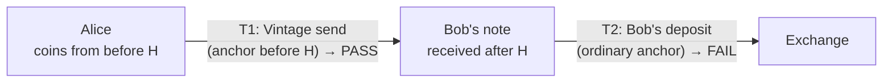

# Roadmap

- [One-hop provenance](#one-hop-provenance): proving that newer coins came from a payment whose inputs
  predate H, with no key disclosed. **Prototype working on mainnet data**: `research/zk-link`.
- [Send from any wallet](#send-from-any-wallet-proof-receipts-and-wallet-integration): a proof for
  any payment, not only exchange deposits, and a path to Vintage sends from other wallets.
  **Researched Oct 28; nothing built yet.**
- [Other items](#other-items)

## One-hop provenance

### The problem

Vintage's core limit is mathematical: once an event's coins enter the pool, any later note *could*
descend from them. So with zero disclosure, a transaction can only prove "my inputs are older than H".
Someone who received a payment *after* H can't prove anything, even if the payer's coins were old.



Bob's coins *are* clean: they came from T1, and T1 provably spent only coins from before H. The goal is
to let Bob prove the link **T2 spent an output of T1**, while revealing as little as possible.

### Prior art, checked

| Work | What it does | Status |
|---|---|---|
| [ZIP 311](https://zips.z.cash/zip-0311), Zcash Payment Disclosures | Sender discloses outputs (via `ock`) and spends. A spend disclosure re-proves the spend against **the transaction's own anchor** and signs a challenge: it proves who *authored* a spend, not *which earlier output* was spent. | Draft. Sapling only ("TODO: Add support for Orchard"). Reference implementation "TBD". |
| [zeceipt](https://github.com/beautifulrem/zeceipt) | Source-of-funds dossiers. Its **Path** claim links a spend to an earlier output: the holder discloses the note opening and the **nullifier key `nk`**, and the reviewer recomputes the nullifier and finds it in the spending transaction. Also checks value coverage (`undisclosed_input_min_zat`). | Apache-2.0 hackathon project, archived 2026-10-01, testnet only, refuses post-NU7 transactions. |

**Built since (Oct 23):** the disclosed-viewing-key version, `vintage link` and `POST /verify-link`
([LINK.md](LINK.md)), proven on mainnet with a NEAR Intents deposit. It discloses one single-use
receipt account's viewing key. What follows is the zero-knowledge version, which discloses no key.

So the link *can* be shown today, zeceipt-style, but only by disclosing `nk`. That has a lasting cost:
anyone who knows one of your note openings (for example, everyone who ever paid you) can use `nk` to
see when you spend that note, forever.

### Route B: a spend proof against a synthetic anchor (no new circuit)

The Ironwood Action circuit (orchard 0.16, post-NU6.3) proves, for each action:

- the spent note is in a Merkle tree whose root is the public **anchor**, *unless the note's value is
  0* (`orchard/src/circuit.rs:328`: "Either v_old = 0, or calculated root = anchor");
- the public nullifier `nf` is that note's nullifier;
- the prover holds the key the note belongs to.

The circuit doesn't care whether the anchor is a real chain root. Consensus does, so a proof with
another anchor can never be mined, but it can still be **verified off-chain**. So:

1. Anyone can build a small Merkle tree whose leaves are exactly **T1's output commitments** (public in
   T1). Its root is the **synthetic anchor** `rt(T1)`.
2. Bob proves an ordinary one-action spend of his note against `rt(T1)`, and signs a challenge from the
   verifier with the spend's randomized key (as in ZIP 311).
3. The verifier recomputes `rt(T1)` from T1, verifies the proof, checks the proof's `nf` is spent in
   T2, and checks the signature. It checks T1 against H with Vintage.

```mermaid
sequenceDiagram
    participant B as Bob (holder)
    participant V as Verifier (exchange)
    participant C as Chain

    V->>B: challenge (nonce)
    B->>C: read T1's output commitments
    B->>B: rt(T1) = root of tree [cmx₀, cmx₁, …]
    B->>B: prove a one-action spend of his note against rt(T1); sign the challenge
    B->>V: disclosure (proof, nf, rk, cv, signature, T1, T2)
    V->>C: read T1 and T2
    V->>V: recompute rt(T1); verify proof against it
    V->>V: nf ∈ T2's nullifiers? signature over the challenge valid?
    V->>V: vintage verify T1 --before H → PASS?
    V-->>B: "T2 spent an output of T1, and T1's inputs predate H"
```

**Bob reveals:** that T2 spent *some* output of T1, plus the value if a value rule needs it (below).
**Bob does not reveal:** which output of T1, his address, the memo, `nk`, or any viewing key.

**Why it's sound:** the Merkle tree is collision-resistant, so a verifying proof against `rt(T1)` with a
non-zero note means the note's commitment is one of T1's. The nullifier is determined by the note, so
`nf` in T2 means T2 spent that note. No new cryptographic assumption is involved.

### Feasibility spike (`research/onehop-spike`)

A local Rust program that uses only orchard 0.16's public APIs: `Builder::new(…,
BundleVersion::ironwood_v3(), …, anchor)`, `add_spend`, `create_proof`, `prepare`/`sign`/`finalize`,
`verify_proof`, `Instance::from_parts`, `Proof::verify`. T1 is a real Ironwood payment bundle to Bob
and Carol. Bob finds his note by trial decryption, as a wallet does.

```
keys:        post-NU6.3 (Ironwood) proving + verifying key built in 7.6s
T1:          2 Ironwood actions (outputs to Bob 150000 zat, Carol 50000 zat, padding)
Bob:         decrypted his note in T1 (value 150000), at output 1
anchor:      synthetic root of T1's outputs = c87bfc6f…b939 (matches incrementalmerkletree)
prove:       one-action disclosure proven and signed in 3.3s
verify:      PASS in 0.04s: proof valid, anchor = T1's outputs root, nf = T2's spend, signature over the challenge valid
             disclosed: nothing about which T1 output, Bob's address, the memo, or nk
forge 1:     note from another tx with T1's anchor → builder refuses (add_spend: AnchorMismatch)
forge 2:     valid proof for another tx, relabelled with T1's anchor → verifier rejects (ConstraintSystemFailure)
forge 3:     Bob's proof presented for a different nullifier → verifier rejects (ConstraintSystemFailure)
total wall 14.42s, peak RAM 86160KB
```

Run it: `cargo run --release -p onehop-spike`.

### Prototype on mainnet data (`research/zk-link`, Oct 24)

The same construction on the real mainnet pair: deposit `df151ee2…9402` spends two notes from the
Vintage payment `da9017e0…e3a7`. `zk-link prove` reads the receipt wallet's key locally and writes one
proof per input; `zk-link verify` checks them with no key and runs the age check on the payment.
Proving took 4 s, verifying 8 s. Result: `ZK LINK PASS`, 2 of 2 inputs, 600,000 zat. Six forgeries
(tampered proof, another payment, another deposit, a missing input, a duplicate, an event before the
payment) are each rejected. Details and output: [research/zk-link/README.md](../research/zk-link/README.md);
the proof file: [demo/mainnet-zk-link.json](../demo/mainnet-zk-link.json).

Two choices differ from the plan below: the value is proven by the bundle's **binding signature** over
its value balance (no separate opening of the value commitment), and the challenge is a hash of the
deposit and payment txids, so proofs can't be reused for another pair.

### Open problems

1. **Value coverage and dummy inputs.** Because the circuit skips the Merkle check for zero-value
   notes, a zero-value note "passes" against any anchor. That's harmless for value, but the verifier
   must count value. Bob opens each proof's value commitment (reveals `v` and the commitment
   randomness). The harder part: wallets pad transactions with **dummy spends** whose keys they throw
   away, so Bob can't prove those. Two policies:
   - *coverage*: proven clean value ≥ the deposited amount + fee (zeceipt reports the same kind of
     bound). This works with today's wallets.
   - *strict*: every input proven. This needs a Vintage-aware wallet that keeps the dummy-spend secrets,
     for example by recording the transaction builder's RNG seed.
2. **The payer has to opt in.** T1 must itself PASS, so Alice must pay with a Vintage send. Ordinary
   anchors are 1–11 blocks old. The realistic case is payouts from holders of old coins: treasuries,
   payroll, or exchanges paying out pre-event reserves.
3. **Privacy cost.** The verifier learns that T2 spent an output of T1, and possibly the value. That
   reveals much less than zeceipt's `nk` route or a viewing key, but it isn't nothing.
4. **Spec and review.** This needs a written statement, likely an extension of ZIP 311 for Ironwood
   "provenance disclosures", plus review by cryptographers, NU7 (mainnet block 3,543,405) keeps the same Orchard
   protocol revision (V3) as NU6.3, so the Ironwood circuit and keys don't change.
5. **Several hops** chain disclosures, and each intermediate transaction must be fully covered. Both the
   privacy cost and the complexity grow per hop.

### Plan

| Phase | What | Estimate |
|---|---|---|
| ✅ 0 | Feasibility spike (above) | done |
| ✅ 1a | Prototype prover and verifier on a real mainnet T1 → T2 pair, *strict* policy, challenge binding, file format (`research/zk-link`) | done Oct 24 |
| 1b | Move it into `vintage link` and add `POST /verify-zk-link` to the API | days |
| 2 | Value coverage with the *coverage* policy, for deposits with dummy inputs | with 1b |
| 3 | Written spec (ZIP 311 extension draft), review, *strict* policy with wallet support | after the hackathon |

## Send from any wallet: proof receipts and wallet integration

### The goal

Someone sends ZEC to anyone (a friend, a shop, their own address), pastes the transaction hash, and gets
a proof that none of the coins it spent came from an event. Later: they do it from the wallet they
already use, or from a website, with the proof produced alongside the payment.

### What already works

- A Vintage send can go to **any address**; nothing about it is specific to exchanges.
- Any transaction hash can be checked, and the result shared as a link that re-checks itself:
  `app.usevintage.site/#tx=<hash>&before=<event>`. "Age only" needs no event at all.
- A PASS covers every coin the transaction **spent**, whatever those coins' earlier history. It says
  nothing about the rest of the wallet; proving a whole wallet clean means disclosing its viewing key,
  the cost Vintage exists to avoid.

The limit: the proof has to be built in when the transaction is signed. An ordinary wallet anchors a few
blocks back, so pasting its hash afterwards proves nothing. Everything below is about getting other
wallets to sign Vintage sends.

### What we found (Oct 28, 2026)

- **No website-to-wallet standard exists for shielded Zcash yet.** A shielded-Zcash app noted on Oct 23
  that there is "no dApp 'connect wallet' standard for shielded Zcash (no browser-extension provider,
  WalletConnect is EVM-only)" and used a ZIP 321 payment request instead
  ([zpredict#134](https://github.com/zpredict/zpredict/issues/134)). Emerging: the Noir browser wallet
  advertises a TypeScript dApp SDK (private beta, pools not stated,
  [repo](https://github.com/NoirWallet/noir-wallet)); Zillions (launched Oct 27) describes a proposed
  "Zconnect" interface for web apps to request signing, as a draft
  ([crypto.news](https://crypto.news/zcash-zillions-browser-wallet-ledger-support/)); ChainSafe's MetaMask
  Snap signs PCZTs inside MetaMask, per its audit, but was announced for Sapling
  ([ChainSafe](https://blog.chainsafe.io/zcash-in-the-browser-bringing-shielded-zec-to-metamask/),
  [Hacken](https://hacken.io/audits/zcash/dapp-zcash-snap-may2025/)). None is confirmed for Ironwood.
- **ZIP 321 payment requests can't ask for an anchor**, but they can *require* a parameter. Only
  `address`, `amount`, `req-asset`, `label`, `memo` and `message` are defined. "If a parser does not
  recognize any variables which are prefixed with `req-`, it MUST consider the entire URI invalid";
  others "SHOULD be ignored" ([ZIP 321](https://zips.z.cash/zip-0321)). So a `req-`-prefixed "before H"
  parameter fails safe: a wallet that doesn't understand it refuses the request, instead of paying
  without the proof. Today `vintage request` puts `VINTAGE before=H` in the memo, which wallets ignore.
- **In v6 transactions the anchor can be set after signing.** [ZIP 374](https://zips.z.cash/zip-0374)
  (PCZT, Draft): "Signatures (spend authorization signatures and binding signatures) do not commit to
  the anchors or witnesses", "A shielded bundle anchor MAY be absent until proving", and "The
  transaction identifier is unchanged by re-anchoring". This applies to Ironwood.
- **librustzcash implements it** (read at eb38d7a): `pczt::roles::updater::Updater::set_ironwood_anchor`
  and `set_ironwood_spend_witnesses` (v6 on NU6.3 or NU7; refuses once an Ironwood proof exists, and
  refuses to *replace* a different anchor); `Redactor` can `clear_anchor` first.
  `zcash_client_backend` has `create_pczt_from_proposal` and `extract_and_store_transaction_from_pczt`.
- **Upstream:** [librustzcash#3196](https://github.com/zcash/librustzcash/issues/3196) (explicit anchor
  height for `propose_transfer`) is open, linked into Zodl's tracker (COR-2586), no discussion yet.

### Routes, most realistic first

**A. Proof receipt (website only).** A page for any transaction: the verdict, the block its coins were in
the pool by, the events it predates, a re-checkable link, and the API's JSON report to download. No
wallet work. The receipt is only final once the transaction is mined, as today.

**B. "Vintage builds, your wallet signs" (PCZT).** Using only the user's viewing key, Vintage proposes the
transfer at the pre-event anchor (the same logic as `vintage send`) and creates a PCZT. The user's signer
(a hardware wallet, MetaMask Snap or any PCZT signer) signs it. Vintage then proves it, extracts the
transaction and broadcasts it. Vintage picks the notes, so post-event notes are never chosen, and the
anchor is set from the start, so nothing is re-anchored.
- Needs a signer that signs PCZTs it didn't create. Hardware wallets work this way; the Snap does per its
  audit. Ironwood support must be checked per signer.
- **Privacy:** the creator and prover see the notes and the viewing key. They must run on the user's
  device (the CLI, or later in-browser WebAssembly), **never on our server**.

**C. Re-anchor a wallet's own PCZT.** The wallet builds and signs as usual and exports the PCZT before
proving. Vintage clears the anchor, sets the root at the grid height below H plus each note's Merkle path
there, then proves. This works with the wallet's own note selection, but only if every chosen note
predates H, so Vintage must check and refuse otherwise. The hard part is the Merkle path at an old height
when the wallet didn't keep that checkpoint: it can be rebuilt from public chain data (Vintage already
recomputes the tree from compact blocks), but this is new work.

**D. Native wallet option.** A "prove these coins predate…" toggle in Zodl, Zingo and others, off by
default, with the visibility warning. Best user experience, slowest: it waits on #3196 or the PCZT route
in each wallet.

**E. Websites.** A "pay with proof" page that shows a ZIP 321 request (route A for the result) works today
with any wallet that supports route B or D. A real "connect wallet" button waits for a shielded standard
(Noir's SDK, Zconnect); build against whichever ships with PCZT signing and Ironwood first.

### Plan

| Phase | What | Estimate (rough) |
|---|---|---|
| 0 | Proof receipt page and downloadable report (route A) | days |
| 1 | `vintage pczt create` / `prove` / `send`: build at the pre-event anchor from a viewing key, sign with an external signer, prove, broadcast; testnet, then a tiny mainnet send (route B) | 1 to 2 weeks |
| 2 | Re-anchor an exported PCZT; Merkle paths at old heights from public data; refuse post-event notes (route C) | 1 to 2 weeks |
| 3 | ZIP draft: a `req-` ZIP 321 parameter for "inputs before block H", and wallet guidance (warning, off by default) | with 1 |
| 4 | Browser version of 1 and 2 (WebAssembly, on-device) and a "pay with proof" page; a wallet connection once a standard ships | after a standard |
| 5 | Work with one wallet team on route D; follow #3196 | ongoing |

### Check before building

- Which signers sign foreign PCZTs **with Ironwood** today (hardware wallets, the Snap, Noir, Zillions).
- Whether the PCZTs wallets export keep the fields the prover needs, or a Redactor strips them.
- Whether NU7 (2026-11-05) keeps these v6 rules; the library already accepts NU7 for re-anchoring.
- A hardware wallet shows amounts and recipients, not the anchor. The user trusts the device for *what*
  is paid and Vintage for the age claim, which anyone can re-check from the mined transaction.

## Other items

- **Explicit-anchor API in librustzcash.** Today `vintage send` reaches an anchor by choosing
  confirmations (`N = target − H_a`). A `propose_transfer` option for an explicit anchor height would
  make this direct. Posted as [librustzcash#3196](https://github.com/zcash/librustzcash/issues/3196)
  (see also [ZIP_DRAFT.md](ZIP_DRAFT.md)).
- ✅ **Follow the grid after NU7** (Oct 31). `vintage send` and `status` use librustzcash's NU7-aware
  `AnchorGrid`: multiples of 144 before NU7, of 432 from it. Tested with a post-NU7 testnet send.
- **Multiple data sources.** Optionally cross-check roots against two independent lightwalletd servers,
  for users who don't run a node.
- **Sapling and Orchard.** The same anchor argument applies to their anchors. Ironwood comes first
  because that's where shielded value lives after 2026-07-28.
- **Wallet integration.** See [Send from any wallet](#send-from-any-wallet-proof-receipts-and-wallet-integration).
- **Registry governance.** Several signers (threshold), and a public process for adding events with
  primary-source transaction ids.
